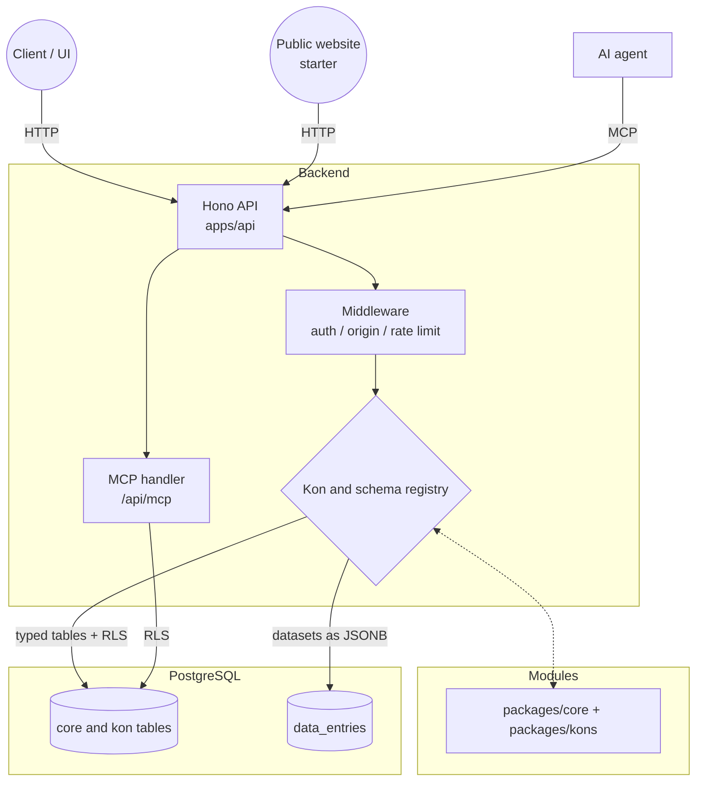

# Kitsuden architecture

The high-level decisions: how the code is organised, how a request flows, and
why dynamic data is stored the way it is. The install side is in
[docs/install/](docs/install/README.md); the engine / core / kons split is in
[CORE.md](CORE.md).

## Folders — three levels

Kitsuden separates **framework batteries** (what every app wants) from
**domain modules** (the apps you build on top). See [CORE.md](CORE.md) for
the full map and the classification rule.

- **`apps/api/` (host):** the runtime. API on Bun + Hono, middleware,
  security, auth, routing, the module loader that mounts kons, migrations, and
  host services coupled to the runtime (Vault, Secrets, auto GraphQL).
- **`packages/engine/` (level 1 — engine):** pure framework primitives,
  imported by `apps/api` and by the kons through `@kitsuden/engine`: authz,
  validation, errors, `repo()`, request scope, interceptors, mail, brain, code
  graph, system map, actions.
- **`packages/core/` (level 2 — core batteries):** `datasets`, `media`,
  `blocks` (page builder), `vector-search`, `content-publishing`. Loaded by the
  module loader like a kon, but they live here to say they are
  infrastructure, not domain.
- **`packages/kons/` (level 3 — domain kons):** where installed kons are
  copied (`kitsuden kon add`); empty in a fresh clone. The business modules
  (CRM, booking, LMS, payments, blog, wiki, games…) live in a separate kons
  repository. Each is an independent unit; `kon-games` is an app on Kitsuden,
  not a framework battery.
- **`packages/grimoires/` (bundles):** sets of kons plus the visual theme; a
  grimoire declares which kons it enables in its `grimoire.json`.
- **`packages/admin/` (admin UI):** the SvelteKit (Svelte 5) admin panel,
  built statically and served by nginx in Docker.
- **`packages/mcp-server/`:** a standalone Model Context Protocol server (the
  API also has its own MCP endpoint, below).
- **`packages/shared/`:** Zod schemas, TypeScript types, the API contracts
  (`contracts.ts`) and utilities shared by every package.
- **`packages/starters/kitsuden-starter-basic/`:** the neutral public website
  (Astro), a separate consumer of the API.

## Data flow

1. **Entry through Hono.** Every request (reading or writing content) first
   hits the Hono routes: headers, sessions or agent keys, Origin checks on
   cookie-authenticated writes, rate limits.
2. **Kon and schema registry.** A route does not hold the domain logic: the
   registry of kons and schemas knows which definitions, fields, relations and
   validations apply to that module.
3. **Persistence.** Core and kon tables are ordinary typed tables with their
   own migrations. Dynamic collections (datasets) store their payload as JSONB
   in the shared `data_entries` table (see ADR-001). Requests that touch
   per-user data run inside a transaction with the user's row-level-security
   context set.

## Model Context Protocol (MCP)

The API exposes an MCP server at `/api/mcp` (when `ENABLE_MCP=true`, the
default in `docker-compose.yml`) so AI agents can use Kitsuden:

- protocol version `2024-11-05`, JSON-RPC 2.0;
- `GET /api/mcp` for the event stream (SSE), `POST /api/mcp` for JSON-RPC
  messages;
- tools defined in `apps/api/src/services/mcp-tools.ts`, for example
  `kitsuden_list_datasets`, `kitsuden_query_dataset`, `kitsuden_insert_record`
  and `kitsuden_dispatch_worker` (queue a job);
- resources such as `kitsuden://datasets` and `kitsuden://kons`.

Agents authenticate with scoped agent keys (`kitsuden_agent_*`) and go
through the same policies and RLS as any other request.

## Architecture decision records

### ADR-001: dynamic models in JSONB (`data_entries`)

> **Dynamic collections are stored as JSONB in `data_entries` instead of
> creating SQL tables on the fly, to avoid migration bottlenecks.**

Letting users change a collection's schema without `ALTER TABLE` avoids
exclusive locks in production and DDL overhead for every collection. When a
collection needs native types and indexes, Vault (opt-in,
`KITSUDEN_VAULT_ENABLED=true`) creates real tables with RLS instead.

### ADR-002: native PostgreSQL row-level security

> **Isolation is enforced in the database, so it holds even when application
> code or an AI-generated query is wrong.**

The user context is set per transaction (`set_config('app.current_user_id',
…)`) and the RLS policies filter rows. RLS only binds when the API connects
with a **non-superuser** role: in Docker the API serves as `APP_DB_USER`, and
the startup script refuses to continue if the isolated tables are not
isolated (`verify-rls.ts`). See
[apps/api/docs/RLS_SETUP_GUIDE.md](apps/api/docs/RLS_SETUP_GUIDE.md).

### ADR-003: MCP for AI agents

> **CMS features are exposed through MCP instead of ad-hoc APIs per agent.**

Any compatible client (Claude, Cursor…) can connect without a specific
integration, and the MCP handler reuses the API's code and its security
(policies, scopes, RLS).

## High-level diagram

