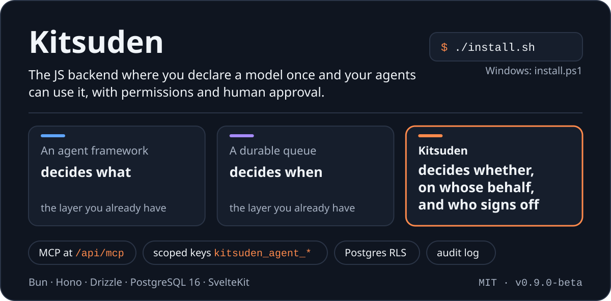

<p align="center">
  
</p>

<p align="center">
  <a href="https://github.com/Kitsuden/kitsuden/actions/workflows/ci.yml"></a>
  
  <a href="LICENSE"></a>
  <a href="https://github.com/Kitsuden/kitsuden/stargazers"></a>
  <br>
  
  
  
  
  
</p>

<p align="center">
  <a href="#quickstart"><b>Quickstart</b></a> ·
  <a href="#why-kitsuden"><b>Why Kitsuden</b></a> ·
  <a href="#for-ai-agents"><b>For AI agents</b></a> ·
  <a href="#kons-installable-modules"><b>Kons</b></a> ·
  <a href="docs/install/README.md"><b>Docs</b></a> ·
  <a href="CHANGELOG.md"><b>Changelog</b></a>
</p>

An agent framework decides _what_ to do and a durable queue decides _when_;
Kitsuden is the third layer, the one that decides **whether an agent may do it
at all, on whose behalf, and who signs off**. Agents connect over MCP or REST
with their own identity and fine-grained scoped keys, every action is audited,
sensitive ones can wait for a human to approve them, and the data layer is
deny-by-default with PostgreSQL row-level security that the API checks before
it serves. Background work runs on a transactional outbox in the same
Postgres. Responses come in the shortest lossless format (compact JSON, TOON
or TRON) to spend fewer tokens.

It runs on **Bun + Hono + Drizzle** over **PostgreSQL 16 (pgvector)**, with a
**SvelteKit** admin panel. Two services are enough: the API and Postgres
(Valkey is optional, for several API replicas). It is meant for a persistent
container next to its database, **not** for edge/serverless runtimes: it keeps
a warm connection pool and one local transaction per request.
See the [threat model](docs/threat-model.md).

<p align="center">
  
</p>

<table>
  <tr>
    <td width="50%" valign="top">
      <h3>🤖 Agents are first-class users</h3>
      MCP and REST with their own identity, scoped keys, audit and human approval for what matters.
      <a href="#1-agents-are-first-class-users">More →</a>
    </td>
    <td width="50%" valign="top">
      <h3>🪙 Fewer tokens</h3>
      Each response in the shortest lossless format (JSON, TOON or TRON): 16.7 % fewer tokens than compact JSON, measured.
      <a href="#2-fewer-tokens-the-shortest-lossless-format-per-response">More →</a>
    </td>
  </tr>
  <tr>
    <td width="50%" valign="top">
      <h3>🛡️ Secure by default</h3>
      Deny by default, row-level security checked at startup, a sandbox for agent code and an authorization matrix in CI.
      <a href="#3-secure-by-default-and-checked">More →</a>
    </td>
    <td width="50%" valign="top">
      <h3>⚡ Fast with every check on</h3>
      RLS, authorization, quotas, approvals, idempotency and audit on every request, and still up to 11× the throughput it had.
      <a href="#4-fast-enough-to-keep-every-check-on">More →</a>
    </td>
  </tr>
</table>

**Who it is for:** developers who want AI agents (Claude, Cursor, their own)
to read and write real application data without handing them a database
password or an admin session, and who want the safe setting to be the
default rather than a checklist.

> [!WARNING]
> **Beta (`0.9.0-beta`).** The public repository is new: expect rough edges, and read
> [docs/install/](docs/install/README.md) before deploying.

<details>
<summary><b>Contents</b></summary>

- [For AI agents](#for-ai-agents)
- [Why Kitsuden](#why-kitsuden)
- [Quickstart](#quickstart)
- [What else is in the box](#what-else-is-in-the-box)
- [Kons: installable modules](#kons-installable-modules)
- [Requirements](#requirements) · [Ports](#ports) · [Local development](#local-development)
- [Documentation](#documentation) · [Repository layout](#repository-layout) · [License](#license)

</details>

## For AI agents

- **Using Kitsuden:** point an MCP client at `/api/mcp` with an agent key, or call REST
  under `/api/*`. `GET /llms.txt` is the agent guide generated from the routes the running
  API mounts. The [`kitsuden` skill](skills/kitsuden/SKILL.md) wraps it, and
  [docs/agents/coding-agents.md](docs/agents/coding-agents.md) sets up Claude Code, Codex
  and Antigravity; system prompts and the tool reference are in [docs/ai/](docs/ai/).
- **Working on this repository:** read [AGENTS.md](AGENTS.md) first (what is off limits,
  how to test). Shared Claude Code permissions are in `.claude/settings.json`, and
  `.claude/skills/` holds step-by-step skills for a core migration, an authorization
  change and the release check.

## Why Kitsuden

### 1. Agents are first-class users

- **MCP server** at `/api/mcp` (on unless `ENABLE_MCP=false`), plus a
  standalone one in `packages/mcp-server/`. Kons add their own tools with
  `defineAction({ trigger: "agent.tool:…" })`.
- **Agent identities with scoped keys.** Create an agent in the panel
  (**Agents → New agent**) or with `POST /api/admin/agents`; it gets a
  `kitsuden_agent_*` key and only reaches what its scopes allow
  (`requireScope("memory:write", …)`). An Inti editor, for example, uses a
  key whose single scope is `content:edit`.
- **Agent audit.** Authentications and actions are written to
  `agent_audit_logs`; `GET /api/admin/agents/:id/logs` and the panel show
  them per agent, next to per-agent rate limits.
- **Agent memory** at `/api/agent/memory`, scoped per agent. Semantic search
  over it is not wired yet (it falls back to text search); pgvector
  embeddings and similarity search live in the `vector-search` core battery.

```bash
curl -H "Authorization: Bearer kitsuden_agent_…" \
     -H "Accept: application/vnd.toon" \
     http://127.0.0.1:3000/api/data-sets
```

- **Errors an agent can act on.** Every `/api/*` error is RFC 9457
  `application/problem+json` with a stable `code` (`KITSUDEN_E_*`, catalogue
  in `@kitsuden/shared`), `retryable`, `retry_after`, `hint` and a `docs`
  link; the MCP server returns the same fields in `error.data` and in failed
  tool results. The old `error` field is still there for existing clients.
- **Safe retries.** Send `Idempotency-Key` on any `POST`/`PUT`/`PATCH`/`DELETE`:
  a retry gets the stored response (`Idempotent-Replayed: true`) instead of
  running twice, a concurrent duplicate gets `409`, and a reused key with a
  different body gets `422`. Stored in Valkey, with a Postgres fallback.
  See [docs/install/errors-and-retries.md](docs/install/errors-and-retries.md).
- **Human approval, when you want it.** Off by default. Turn it on in the
  panel (**Approvals**) globally, or per agent ("propose only"), and an
  agent's sensitive requests (every `DELETE` by default; adjustable per
  operation) are not executed: they become proposals (`202`,
  `KITSUDEN_E_APPROVAL_REQUIRED`, over REST and MCP) that a human approves or
  rejects in an inbox with the diff. Approved ones run once, with the agent's
  current permissions; everything is audited.
  See [docs/agents/approvals.md](docs/agents/approvals.md).
- **Agent-written code goes through a pipeline, never straight to
  production.** A draft of an action's code is versioned, tested in the
  sandbox with a simulated API, scanned locally and compared with what the
  active version may do; a human approves it (suggestion, the default) or it
  activates by itself only when nothing widens permissions (turbo). A watch
  window rolls it back automatically on errors.
  See [docs/agents/promotion.md](docs/agents/promotion.md).

### 2. Fewer tokens: the shortest lossless format per response

The same data can be served as **compact JSON**, **TOON**
([toonformat.dev](https://toonformat.dev): flat lists become tables) or
**TRON** ([tron-format.github.io](https://tron-format.github.io): repeated
object shapes are declared once), and an **`auto`** mode encodes each
response in all three, checks that each decodes back to exactly the same
data, and sends the shortest. MCP tools use `auto` by default; over REST ask
with `Accept: application/vnd.kitsuden.auto` (or `?format=auto`). The
response says which format it is (`Content-Type`, `X-Kitsuden-Format`, or
`_meta["kitsuden/format"]` in MCP). `Accept: application/json` always gets
JSON, so existing clients do not change.

<details>
<summary><b>How much it saves, and how it was measured</b></summary>

Measured on 24 real responses from a copy of a production database
([docs/agents/benchmarks.md](docs/agents/benchmarks.md), `o200k_base`
tokenizer): `auto` used **16.7 % fewer tokens than compact JSON** (15.6 % and
16.2 % with two other tokenizers) and 37 % fewer than pretty-printed JSON,
picking the best of the three formats on 24 of 24 responses. TOON on its own
is 7 % **bigger** than compact JSON on this data (it only wins on flat lists);
TRON on its own saves 16.6 % but is a young library (`0.1.3`, pinned), so it
is only ever sent after the round-trip check. Cost: up to ~30 ms of encoding
and checking on a 220 KB response, under 4 ms below 16 KB.

</details>

### 3. Secure by default, and checked

- **Deny by default**: policies and gates (`definePolicy`, `can`) in
  `@kitsuden/engine`; an action with no rule is denied.
- **Row-level security verified at startup**: in production the API refuses
  to start if its connection is a superuser or has `BYPASSRLS`, because
  Postgres silently skips RLS for those roles
  (`apps/api/src/lib/rls-connection-guard.ts`).
- **An authorization matrix**: every route is classified with the identities
  allowed to reach it (`apps/api/src/middleware/authorization-matrix.ts`; the kons' routes are in `authorization-matrix.kons.json` in their repository, loaded with `KITSUDEN_KONS_MATRIX`).
  CI checks the table and its comparator on every push; the full run, which
  mounts the real app with every kon and calls each route as six real
  identities, needs a test database (`tests/unit/authorization-matrix.test.ts`).
- **Fail-closed rate limits** on sensitive routes when Valkey is down, and
  Origin checks on cookie-authenticated writes.
- **A closed front door in production**: the first administrator needs a
  one-time setup token that only appears in the API log, public sign-up
  (`KITSUDEN_SIGNUP`) is closed by default, and the API refuses to start while a
  secret still holds a placeholder copied from an example file.
- **User code is sandboxed for real**: code actions and functions (which an
  agent may write) run in a WebAssembly interpreter (QuickJS) inside a child
  process with an empty environment and Node's permission model. No files, no
  sockets, no processes, no secrets; `fetch` only to allow-listed hosts; the
  Kitsuden API only as an identity with the scopes the action declares and the
  caller already has, through the same `can()`, RLS, quotas and approvals.
  Hard memory and time limits. Off in production unless
  `ENABLE_CODE_ACTIONS=true` ([docs/agents/sandbox.md](docs/agents/sandbox.md)).
- **The running API holds no superuser**: migrations and RLS checks use
  `DATABASE_ADMIN_URL` at startup, and the script unsets it before starting the
  API. Runtime DDL (hot kon activation, Vault) can use an optional limited
  role, `DATABASE_DDL_URL`.

### 4. Fast enough to keep every check on

Every request still runs its full chain: RLS transaction, authorization,
quotas, approvals, idempotency and audit. What was made cheaper is how those
checks are done, measured with a load benchmark against a copy of a
production database ([scripts/bench](scripts/bench/README.md), results and
method in [docs/agents/benchmarks.md](docs/agents/benchmarks.md#3-load-and-latency)).
With 50 concurrent connections, on one shared laptop, before → after:

| Scenario                                |        req/s |      p95 latency |
| --------------------------------------- | -----------: | ---------------: |
| Agent (API key) reading dataset entries | 26.9 → 101.7 |   3,092 → 531 ms |
| Agent idempotent write                  | 21.9 → 109.1 |   3,455 → 560 ms |
| MCP `tools/list`                        |  9.4 → 108.7 |   5,665 → 546 ms |
| MCP tool call through the kon SDK       |  10.7 → 42.7 | 4,841 → 3,152 ms |
| Blog list with a session                |  19.5 → 36.0 | 3,497 → 1,782 ms |

<details>
<summary><b>What changed, and how pessimistic these numbers are</b></summary>

The biggest cost was the agent key's argon2 hash, verified on every request
(and twice per MCP message); a successful verification is now remembered per
key and secret, while the key and the agent are still read from the database
on every request, so revocation still applies on the next one. Anonymous
public reads moved within the run-to-run noise of that machine. The figures
are pessimistic: there, a round trip to Postgres took 1.3 ms when idle and
much more under load.

</details>

## Quickstart

You only need Docker Engine 24+ with `docker compose` v2.

```bash
git clone https://github.com/Kitsuden/kitsuden.git
cd kitsuden
./install.sh
```

On Windows, in PowerShell:

```powershell
powershell -ExecutionPolicy Bypass -File install.ps1
```

It generates every secret in `.env`, builds the images here from your checkout (5 to
15 minutes the first time, and a few GB of RAM: nothing is published to a registry yet,
and compose never pulls them), starts everything on this machine only and prints what
to do next:

1. Open the panel URL it prints (`http://localhost:3001`) and create the first
   administrator. It asks for a one-time **setup token**, which the API prints in its
   log when it starts with no administrator; the installer shows it, and you can read
   it again with `docker compose -f docker-compose.yml logs kitsuden_api | grep -A4
"No administrator"`. A restart prints a new one.
2. Create an agent under **Agents** and copy its key.
3. Point your MCP client at `http://localhost:3000/api/mcp`.

Public sign-up stays refused until that first administrator exists, and afterwards it
stays closed unless you set `KITSUDEN_SIGNUP=open` (the default in production is
`closed`).

If another Kitsuden or another program already uses those names or ports, it picks free
ones and tells you. Run it again to start a stopped install; `./install.sh --rebuild`
after updating the code. Always pass `-f docker-compose.yml` when you use compose
yourself, so a local `docker-compose.override.yml` is never merged by accident. Doing
the same steps by hand: [docs/install/server.md](docs/install/server.md).

For a public server with a domain, TLS and a website:
[docs/install/server.md](docs/install/server.md) (`./scripts/deploy.sh`
builds and starts `docker-compose.yml` + `docker-compose.tls.yml`).

## What else is in the box

- **Content**: page builder (`kon-blocks`), media library with image
  presets (local volume or S3), datasets (collections with an automatic REST
  API); blog, comments and newsletter are installable kons. Kitsuden does not render your website: a
  public site is a separate project that reads the API, and the repository
  ships a neutral Astro one (`packages/starters/kitsuden-starter-basic`).
- **APIs**: REST under `/api/*`, an auto-generated GraphQL endpoint
  (`/api/graphql`, auth and RLS enforced per request), OpenAPI docs at
  `/api/docs` when enabled.
- **Kons**: domain features as installable modules, below. Curated sets of
  kons are **grimoires**. See [CORE.md](CORE.md).
- **Operations**: one Docker Compose stack bound to `127.0.0.1`, an optional
  TLS overlay with Caddy, migrations applied on every start, and a backup
  service (`pg_dump` plus media archives).

## Kons: installable modules

The core is a complete backend for agents on its own. Domain features — blog,
wiki, comments, newsletter, CRM, payments, tournaments, game tooling… — are
**kons**: modules that you install when you need them. They live in a separate
repository, [`kitsuden-kons`](https://github.com/Kitsuden/kitsuden-kons) (MIT).
Clone it next to this one: until a public registry runs, `kon add` installs from
that local checkout (`--from ../kitsuden-kons`):

```bash
pnpm install --frozen-lockfile        # needs Bun first, see Requirements
pnpm --filter @kitsuden/cli build     # the CLI is not on npm yet
pnpm kitsuden kon list --available --from ../kitsuden-kons   # what is available, with maturity
pnpm kitsuden kon add blog --from ../kitsuden-kons           # copy, pnpm install, migrations
pnpm kitsuden kon list
```

`pnpm kitsuden` runs the CLI from this repository, wherever these docs say
`kitsuden`. Installing from git is installing **unsigned** code: `kon add` shows
the source and the commit, asks for a yes (`--trust-source` in a script) and
records the commit. A signed registry checks the publisher
([docs/kons/registry.md](docs/kons/registry.md)); the CLI supports one, but no
public registry is running yet.

Each kon declares its maturity (**stable**: used end to end in production;
**beta**: tested, with gaps; **experimental**: nobody has used it end to end
yet) and the kon SDK version it needs; Kitsuden refuses to mount a kon written
for a newer SDK than it provides (`GET /api/version` → `sdk.kons`). The
Docker image installs the kons listed in `KITSUDEN_KONS`. See
[docs/kons/installing.md](docs/kons/installing.md), and
[docs/kons/core-and-kons.md](docs/kons/core-and-kons.md) for what is core and
why.

## Requirements

| For                           | You need                                                                                                                                                                                                                                                                                                                                 |
| ----------------------------- | ---------------------------------------------------------------------------------------------------------------------------------------------------------------------------------------------------------------------------------------------------------------------------------------------------------------------------------------- |
| The server path (recommended) | Docker Engine 24+ with the `docker compose` v2 plugin (BuildKit). Builds are memory-hungry: 4 GB of RAM is tight, add swap.                                                                                                                                                                                                              |
| Local development             | **pnpm 9** (`packageManager: pnpm@9.15.4`), **Node.js 22.12+** (22.23.4+ to build the starter: Astro requires it), **Bun 1.3+** (the API runs on Bun, and `@kitsuden/shared` builds with Bun in its `prepare` script, so install Bun **before** `pnpm install`), and Postgres 16 + pgvector (containers are fine; Valkey 7 is optional). |

The packages are used from this monorepo (a pnpm workspace) and the images are
built from source.

## Ports

All published on `127.0.0.1` only. `BIND_ADDRESS` can open the API and the panel, never Postgres or Valkey:

| Port       | Service                                                                                                          |
| ---------- | ---------------------------------------------------------------------------------------------------------------- |
| 3000       | API (in Docker; `PORT=3000` in `apps/api/.env.example` for local runs — without `PORT` the API defaults to 3001) |
| 3001       | Admin panel (nginx, Docker; the container itself listens on 8080)                                                |
| 5173       | Admin panel in development (`pnpm dev:admin`, Vite)                                                              |
| 5432       | PostgreSQL                                                                                                       |
| 6379       | Valkey                                                                                                           |
| 4321       | The neutral starter (`pnpm --filter @kitsuden/starter-basic dev`)                                                |
| 9000, 9001 | SeaweedFS S3 and its panel, only with `--profile s3` or `docker-compose.dev.yml`                                 |
| 80, 443    | Caddy, only with `docker-compose.tls.yml` — the only ports meant to be public                                    |

## Local development

```bash
git clone https://github.com/Kitsuden/kitsuden.git
cd kitsuden
npm i -g pnpm@9.15.4                 # after installing Bun 1.3+
pnpm install --frozen-lockfile
cp apps/api/.env.example apps/api/.env   # DATABASE_URL, REDIS_URL, BETTER_AUTH_SECRET…
pnpm db:migrate                      # bun run scripts/migrate.ts in apps/api
pnpm dev:api                         # API on http://localhost:3000
pnpm dev:admin                       # panel on http://localhost:5173
pnpm --filter @kitsuden/starter-basic dev   # website on http://localhost:4321
```

Checks: `pnpm qa` runs typecheck and lint; `pnpm test:unit` runs the vitest suite
in `tests/unit`; `pnpm test:cli` runs the CLI's own tests; `pnpm test:db:up`
starts a test Postgres (`docker-compose.test.yml`, port 5434) and migrates it, and
`pnpm test:api` runs the API's Bun tests against it, with the settings in `.env.test`
(`pnpm test:api:all` does the whole round).
`pnpm format:check` and `pnpm lint` run in CI and block a merge.

Postgres and Valkey containers, the minimum `.env` and the caveats are in
[docs/install/local.md](docs/install/local.md). Do not use `pnpm db:push`
against a real database: migrations go through `apps/api/scripts/migrate.ts`.

## Documentation

- **[Installation guide](docs/install/README.md)** — local, server, first
  run, variables, the starter, Inti, upgrades and backups, versions,
  troubleshooting.
- [Errors and safe retries](docs/install/errors-and-retries.md) — the
  `KITSUDEN_E_*` catalogue, `problem+json` and `Idempotency-Key`.
- [Agent permissions, keys and quotas](docs/agents/permissions.md) and
  [Human approval](docs/agents/approvals.md) — what an agent may do, and
  what it may only propose.
- [The code sandbox](docs/agents/sandbox.md) — where user and agent code runs,
  what it can reach, and the database credentials the API keeps.
- [Code promotion](docs/agents/promotion.md) — how code an agent writes is
  tested, scanned, approved (or activated in turbo mode) and rolled back.
- [CORE.md](CORE.md) — engine, core batteries and kons: what goes where.
- [ARCHITECTURE.md](ARCHITECTURE.md) — request flow, data model decisions, MCP.
- [docs/operations.md](docs/operations.md) — migrations, RLS and backups. Read
  it before pointing Kitsuden at a database that already exists: `--baseline`
  is a one-time manual step.
- [apps/api/docs/RLS_SETUP_GUIDE.md](apps/api/docs/RLS_SETUP_GUIDE.md) — why
  RLS only binds with a non-superuser role.
- [packages/starters/kitsuden-starter-basic/README.md](packages/starters/kitsuden-starter-basic/README.md) — the neutral website.
- [packages/cli/README.md](packages/cli/README.md) — `kitsuden new` and
  `kitsuden make` (run from the repository: `pnpm kitsuden`, after
  `pnpm --filter @kitsuden/cli build`).
- [CHANGELOG.md](CHANGELOG.md).

## Repository layout

```
apps/api/            the API (Bun + Hono + Drizzle): routes, auth, module loader, migrations
packages/engine/     @kitsuden/engine: policies, validation, errors, repo(), request scope, mail…
packages/core/       core batteries: datasets, media, blocks, vector search, content publishing
packages/kons/       installed kons (copies made by `kitsuden kon add`; empty in the repo)
packages/grimoires/  curated sets of kons + theming
packages/admin/      the SvelteKit admin panel
packages/shared/     @kitsuden/shared: types, Zod schemas, API contracts
packages/sdk/        @kitsuden/sdk: JS/TS client
packages/sdk-python/ the Python client
packages/sdk-react/  React bindings for the SDK
packages/mcp-server/ MCP server for AI agents
packages/cli/        the kitsuden CLI
packages/starters/   kitsuden-starter-basic, the neutral Astro website
docker/              Dockerfiles, Caddyfile, startup and backup scripts
```

## License

[MIT](LICENSE).

---

<p align="center">
  <sub>Built by <a href="https://github.com/Kitsuden">Kitsuden</a> ·
  <a href="https://github.com/Kitsuden/kitsuden-kons">Kons</a> ·
  <a href="https://github.com/tallao-ui/tallao">tallao</a> ·
  <a href="docs/install/README.md">Docs</a> ·
  <a href="https://github.com/Kitsuden/kitsuden/issues">Issues</a></sub>
</p>
